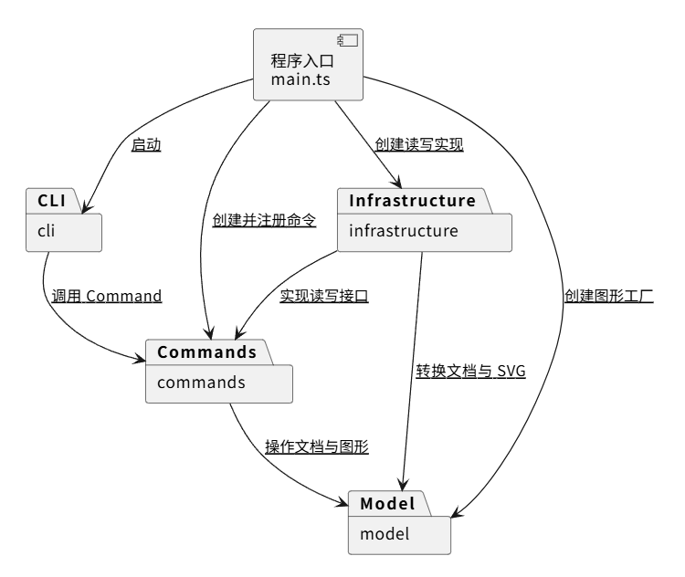
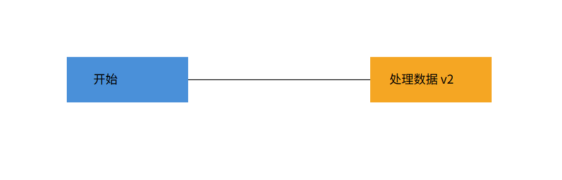

# SVG 命令行编辑器实验

使用 TypeScript 和面向对象方式开发命令行 SVG 编辑器，
通过 AI 协作分阶段完成设计、实现与验证。

当前已实现主要命令及基本 SVG 文件读写。
本文记录当前架构、开发过程和验证情况，尚未完成最终验收。

## 运行方法

需要安装 Node.js 和 npm。

在项目根目录执行：

```bash
npm ci
npm run typecheck
npm run build
npm run cli
```

进入 svg> 后输入 help 查看命令，按 Ctrl+C 退出。
相对文件路径以启动程序时的工作目录为基准。

## 架构方案

### 1. 模块划分

| 模块 | 职责 |
| --- | --- |
| src/main.ts | 创建对象、连接依赖、注册命令并启动程序 |
| src/cli | 接收输入、解析参数、调用命令和显示结果 |
| src/commands | 封装命令，管理当前会话和编辑历史，定义文件读写接口 |
| src/model | 管理文档、图形、容器、几何规则和 SVG 元素表示 |
| src/infrastructure | 实现文件读写及 XML 解析 |

主要类及职责：

| 类或接口 | 职责 |
| --- | --- |
| CliApplication | 终端输入循环、帮助显示、结果与错误输出 |
| CommandParser | 解析命令参数，保留双引号内的空格和空字符串 |
| Command | 定义统一的命令执行接口 |
| 各具体命令类 | 校验命令参数并调用模型操作 |
| EditorSession | 保存当前文档和文件路径 |
| CommandHistory | 管理撤销栈、重做栈和文档操作后的历史限制 |
| HistoryEditCommand | 包装编辑命令，将其接入历史管理 |
| SvgDocument | 保存画布尺寸、根级图形，维护查找和层级操作 |
| Shape | 定义图形公共接口及父级信息 |
| Rect、Circle、Ellipse、Line、Text | 实现五种叶子图形的行为 |
| Group | 保存子图形，实现容器操作 |
| ShapeFactory | 根据类型创建图形，并从 SVG 元素还原图形 |
| SvgElement | 保存 SVG 元素结构，生成经过转义的 XML |
| DocumentReader、DocumentWriter | 定义文件读写接口 |
| DocumentReadResult | 封装读取后的文档与警告 |
| SvgFileReader、SvgFileWriter | 实现文件访问 |
| SvgXmlParser | 解析 XML、检查已有 ID、补全缺失 ID |

模块依赖图：



对应的 PlantUML 源码：

```text
@startuml
component "程序入口\nmain.ts" as Main

package "cli" as CLI
package "commands" as Commands
package "model" as Model
package "infrastructure" as Infrastructure

Main --> CLI : 启动
Main --> Commands : 创建并注册命令
Main --> Model : 创建图形工厂
Main --> Infrastructure : 创建读写实现

CLI --> Commands : 调用 Command
Commands --> Model : 操作文档与图形
Infrastructure --> Commands : 实现读写接口
Infrastructure --> Model : 转换文档与 SVG
@enduml
```

### 2. 设计模式及实现

#### Command：封装命令

Command 接口统一提供 execute 方法。
InitCommand、CreateCommand、MoveCommand 等类分别封装具体操作，
CLI 通过命令表查找和调用，不负责实现图形编辑逻辑。

HistoryEditCommand 包装编辑命令，
由 CommandHistory 保存执行前的文档快照。

当前历史规则：

- 一条成功的编辑命令对应一个撤销单元。
- 失败的编辑命令不进入历史，并恢复执行前的文档状态。
- undo 恢复上一状态，redo 恢复重做状态。
- 撤销后执行新编辑，会清空重做记录。
- 显示命令不进入编辑历史。
- 成功执行 init、read、save 或修改画布尺寸后，
  清空历史并禁止撤销重做，直到下一次成功编辑。

#### Composite：统一操作容器与叶子

Shape 定义移动、缩放、属性修改、显示、复制和 SVG 转换等操作。
Rect、Circle、Ellipse、Line、Text 是叶子图形，
Group 保存子图形。

Group 通过递归调用子图形的方法，实现整体移动、缩放和深复制。
编辑命令通过 Shape 接口工作，不需要逐一判断具体图形类型。

SvgDocument 保存根级图形，Group 保存直接子图形。
查找操作递归遍历子树，支持通过 ID 定位任意层级的图形。

容器样式保存在容器本身，保存为 g 元素的属性，
不直接覆盖子图形已有的样式。

#### 完整文档快照

Shape 和 SvgDocument 通过 clone 创建独立副本，
CommandHistory 使用这些副本保存和恢复文档状态。

恢复时再次复制快照，避免后续编辑修改历史记录。

这种方案便于保证复杂层级操作的撤销完整性，
但内存和复制开销随文档规模及历史数量增长。
当前优先保证正确性，暂未改为增量历史。

#### 图形工厂与按名分派

ShapeFactory 集中负责图形创建和 SVG 元素还原。
图形自身负责几何行为，编辑命令不按图形类型分派。

命令名到实现的注册集中在 main.ts 的命令表，
图形类型名到类的分派集中在 ShapeFactory。
按实验要求，将这两处记录为后续待重构点。

### 3. 依赖方向规则

- 程序入口可以依赖所有模块，负责对象组装。
- cli 可以依赖 commands，不依赖具体图形和文件读写实现。
- commands 可以依赖 model，不依赖 infrastructure 的具体类。
- infrastructure 可以依赖 commands 中的读写接口和结果类型，
  并依赖 model 完成文档转换。
- model 不依赖 cli、commands、infrastructure 或文件系统。

读写接口由命令层定义，基础设施层提供实现。
入口将具体实现传给命令，使文件访问方式可以替换。

SvgElement 不访问文件系统，但它使模型对 SVG 格式存在一定耦合。
当前应用专注于 SVG，暂不为多种输出格式增加额外抽象。

违反以上规则的依赖应记录为待处理项，
最终通过检查各文件 import 关系复查。

### 4. 变化点假设

| 可能变化 | 当前安排与取舍 |
| --- | --- |
| 新增图形类型 | 扩展 Shape 子类，在工厂中注册；暂不实现插件加载 |
| 新增图形界面 | 模型和命令不直接输出终端，可复用；本阶段不实现 GUI |
| 更换文件存储方式 | 通过 DocumentReader、DocumentWriter 接口替换实现 |
| 扩展 SVG 导入能力 | XML 解析集中在基础设施层，类型还原集中在工厂 |
| 文档规模增大 | 当前采用完整快照，后续可评估增量记录和历史数量限制 |
| 调整显示格式 | 当前 tree 复用 describe 文本，存在格式耦合，后续可拆分显示接口 |
| 统一样式与数值校验 | 当前图形间存在重复逻辑，后续考虑提取公共实现 |

### 5. 架构修订记录

1. 初版仅允许 infrastructure 依赖 model。
   引入读写接口后，允许 infrastructure 依赖 commands 中的接口及结果类型。

2. 初期由 CliApplication 创建会话、历史管理器及各命令对象，
   产生了对模型和基础设施的直接依赖。
   后续将对象组装移至 main.ts，CLI 通过构造方法接收命令表。

3. 图形存储从平铺结构扩展为树形结构。
   SvgDocument 保存根级图形，Group 保存直接子图形，
   查找和 ID 校验覆盖整棵图形树。

## 过程记录

以下记录根据开发过程、Git 提交和实际操作补记。
AI 提供了代码建议及解释，我通过运行、查看输出和浏览器预览检查结果，
并根据发现的问题调整实现。

### 1. 开发环境与项目初始化

配置 TypeScript、tsx 和 Node.js 类型定义，
添加 cli、typecheck、build 脚本，
通过 .gitignore 忽略 node_modules 和编译产物。

配置过程中曾将 tsconfig.json 放进 node_modules。
发现后移至项目根目录，并重新进行类型检查和编译，
避免把错误目录下的配置当作已生效配置。

### 2. 命令行入口

实现 CliApplication，由 main.ts 创建并启动。
支持提示符、help、跳过空行与注释，以及未知命令错误提示。

运行时曾仍然输出初始化测试文字。
检查发现 main.ts 尚未调用 CliApplication，
修改入口并保存后能够进入 svg> 输入循环。

出现过编辑器报告 Node.js 模块类型错误、
但命令行类型检查通过的情况。
检查了类型依赖和配置，并排查编辑器 TypeScript 服务及项目关联。

### 3. 画布与文档命令

实现 SvgDocument、EditorSession 和 Command 接口，
接入 init、canvas。

尺寸由文档模型封装，修改前先检查所有参数。
验证了默认尺寸、尺寸修改、未初始化时的错误提示，
以及非法尺寸和非数字参数的拒绝。

非法 resize 和 init 后，原画布仍保持 400×300，
确认失败没有破坏已有文档。

### 4. 矩形创建与属性查看

实现 Shape、Rect 和 ShapeFactory，
接入 create rect 和 show。

验证了创建、属性显示、重复 ID 拒绝及不存在的 ID 提示。
非法矩形创建失败后，相同 ID 仍可用于合法创建。

show 调用图形的 describe 方法，不在命令中按类型分派。

### 5. 移动与缩放

接入 move、scale，通过 Shape 的统一方法操作图形。

验证了移动只改变位置，缩放同时改变位置和尺寸。
零缩放倍数和非数字位移参数被拒绝，
失败后矩形属性保持不变。

### 6. 撤销与重做

为图形和文档增加 clone 方法，通过独立副本保存历史状态。
CommandHistory 管理历史，
HistoryEditCommand 将已有编辑命令接入撤销重做。

验证了撤销后执行新编辑会清空重做记录。
查看尺寸不影响历史，修改尺寸后禁止撤销，
符合实验文档第 4.3 节的规则。

### 7. 属性修改

通过 setAttribute 接口接入 set，
支持类型自身的几何属性及公共样式属性。

新增样式字段时同步更新 clone，
确保撤销重做不会丢失描边等属性。

验证了属性修改、撤销重做，以及非法宽度和未知属性拒绝。
非法修改后，原图形属性保持不变。

### 8. 补齐五种叶子图形

增加 Circle、Ellipse、Line、Text，
均继承 Shape，实现统一操作及复制方法。

新增类型时主要扩展模型和工厂，
无需修改已有移动、缩放、删除和查看命令。

通过 CLI 验证了各类型的基本操作及属性修改。
非法半径和非数字参数被拒绝。

### 9. 双引号参数解析

原先按空白拆分输入，不能正确处理带空格文字。
新增 CommandParser，逐字符解析命令，
保留双引号内的空格，并支持空字符串参数。

验证了带空格英文、中文和空文本。
未闭合引号会报错，不修改文档状态。
当前尚不支持双引号转义。

### 10. 容器与层级操作

新增 Group，并在 Shape 中记录父容器 ID。
容器与叶子共同使用 Shape 接口。

实现 create g、in、tree、addto、group、ungroup、front 和 back。

通过手动场景检查嵌套创建、父级显示、整体移动、
容器删除与撤销恢复、移动归属及分组解组。

解组后子图形占据原容器的位置，保持顺序。
同时检查了循环嵌套拒绝、根级容器解组拒绝，
以及同级图层调整与撤销重做。

### 11. SVG 保存

引入 DocumentWriter 接口，
由 SvgFileWriter 实现实际文件写入。

各图形通过 toSvgElement 转换为 SVG 元素，
由 SvgElement 统一生成 XML 并转义特殊字符。

保存成功后更新当前文件路径并禁止撤销重做。
首次指定路径后，可以通过无参数 save 保存到当前路径。

浏览器预览显示了矩形及中文、英文和特殊字符内容。

### 12. SVG 读取与 ID 补全

使用 XML 解析库读取元素树，
由 ShapeFactory 将元素还原为图形对象。

先扫描全部已有 ID，再为缺失 ID 的元素补名，
防止自动生成的名字与文件后面的已有 ID 冲突。

读取过程先构建新文档，成功后才替换当前文档，
警告也在成功后返回。

在包含无 ID 矩形及已有 rect1 的文件中，
无 ID 矩形被分配为 rect2。
无 ID 容器和文字分别补为 g1、text1。

保存读入结果后，在浏览器确认两个矩形和
“你好 & SVG”正常显示，嵌套结构及文字内容得到保留。

### 13. 对象组装调整

初期 CLI 同时负责组装对象和终端交互，
与初版依赖规则不一致。

将会话、历史、工厂、文件读写器和命令表的创建移至 main.ts。
CliApplication 改为通过构造方法接收命令表，
减少对具体实现的依赖。

### 14. 当前待处理项

- 图形间重复的样式处理和数值解析逻辑需要整理。
- tree 依赖 describe 的输出格式，需要检查显示职责。
- 已删除帮助中的“当前仅实现 help”过时说明；
  命令语法和成功反馈仍需与实验要求逐项核对。
- create 的 in 尾缀解析尚需补充边界场景验证。
- 图形工厂和命令注册中的按名分派保留为待重构点。
- SVG 导入范围有限，不能视为支持任意外部 SVG。

### 15. 修复解组后的继承样式丢失

浏览器对比发现：未指定颜色的矩形在容器内继承红色，
解组后变为默认黑色。

修改解组逻辑，在删除容器前，将其公共样式补给未显式
指定对应属性的直接子图形，保留子图形自身的样式。

CLI 验证中，继承颜色的矩形解组后保持红色，
显式蓝色矩形保持蓝色；撤销恢复原结构和属性，
重做后结果一致。浏览器预览结果符合预期。

### 16. SVG 变换保留

为 Shape 增加 transform 保存与复制能力。
读取和保存时保留图形及容器的变换，show、tree 显示变换信息。
解组时将原容器的变换组合到直接子图形。

验证了嵌套 translate、scale 的读取、解组、撤销重做及保存读回。
浏览器对比原文件与结果文件，矩形位置和大小一致。

当前编辑仍使用局部坐标，未完整校验所有变换表达式，
根 svg 上的 transform 暂不支持。

## 一致性自查

### 1. 模块划分

当前已有 src/cli、src/commands、src/model、
src/infrastructure，程序入口为 src/main.ts，
与修订后的模块方案对应。

相较初版，增加了以下职责：

- commands 中定义文档读写接口和读取结果类型。
- model 中增加 SvgElement，负责 SVG 文本表示。
- 图形存储由平铺结构改为树形结构。

以上调整已记入架构说明和修订记录。

Shape 与 Group 已实现容器和叶子的统一操作。
最终仍需检查是否存在职责过重的类及不必要的重复实现。

通过检索已跟踪源码中的类声明，检查了类名和文件名，
未发现一个文件声明多个类或类名与文件名不一致的情况。

### 2. 依赖方向

当前设计使用以下方向：

- main 组装各模块。
- cli 依赖 commands。
- commands 依赖 model。
- infrastructure 依赖 commands 的读写接口和结果类型，
  同时依赖 model。
- model 不依赖上层模块或文件系统。

通过 git grep 检查当前已跟踪源码中的 import，
未发现违反修订后模块依赖规则的导入。

CliApplication 不再依赖具体命令、工厂和文件读写实现；
commands 未直接依赖 infrastructure；
model 的导入均位于模型模块内部。

本次检查覆盖静态导入，程序入口的对象组装另行核对。

### 3. 实现边界

当前支持 rect、circle、ellipse、line、text、g 六种类型。
box 和插件加载属于后续阶段，本阶段不实现。

当前 SVG 导入限制包括：

- width、height 要求为数字或 px。
- viewBox 仅接受原点为零且尺寸与画布一致的形式。
- 支持保留图形及 g 容器的 transform，并在解组时组合到子图形。
  编辑命令仍操作局部坐标；根 svg 的 transform 暂不支持，
  也未完整校验所有变换表达式。
- CSS、字号等额外 SVG 属性尚未完整处理，
  部分属性读回再保存时可能丢失。

这些限制已记录，但仍需结合实验要求评估和修正，
不能以记录限制代替必要实现。

## 质量保证手段

### 1. 类型检查与编译

各开发阶段执行：

```bash
npm run typecheck
npm run build
```

用于发现类型、接口实现及编译问题。
检查通过不等于功能完整，需要结合运行结果验证。

### 2. CLI 手动验证

开发过程中检查了以下场景：

| 类别 | 检查内容 |
| --- | --- |
| 输入 | 空行、注释、帮助、未知命令 |
| 参数解析 | 双引号内空格、空文本、未闭合引号 |
| 文档 | 默认尺寸、修改尺寸、未初始化访问、非法参数 |
| 图形 | 创建、查看、重复 ID、不存在的 ID |
| 编辑 | 移动、缩放、属性修改、删除及失败后状态 |
| 历史 | 撤销、重做、新编辑清空重做记录、文档操作后的限制 |
| 容器 | 嵌套创建、整体移动、父级变化、分组解组和循环拒绝 |
| 顺序 | 同级 front、back 及撤销重做 |
| 文件 | 保存、读回、缺失 ID 补全和已有 ID 避让 |

验证了两层嵌套容器的整体缩放：
子孙图形的位置和尺寸均乘以倍数，
撤销后几何属性及父子关系恢复。
目前主要采用交互式手动验证，
尚未建立自动化测试和统一的回归脚本。

### 3. 两节点流程图与浏览器预览

按实验案例创建两个包含矩形和文字的节点，并添加连接线。
移动第二个节点后撤销，再修改文字，保存并重新读取文件。

读回后的层级、顺序、坐标、颜色及文字符合预期。
浏览器显示两个节点和连接线，
文字为“开始”和“处理数据 v2”。



另外，通过导入测试文件、保存并预览，
检查了中文、空格及 & 字符的读写。

预览只覆盖已测试样例，不代表支持全部 SVG 语法。

### 4. 文件操作异常验证

| 异常场景 | 观察结果 |
| --- | --- |
| 保存到不存在的目录 | 输出 cannot write file，随后可撤销此前的移动 |
| 读取不存在的文件 | 输出 cannot read file，原文档保留，随后可撤销移动 |
| 读取格式错误的 XML | 拒绝导入，原文档和历史保留 |
| 读取包含重复 ID 的 SVG | 报告重复 ID，原文档和历史保留 |

上述场景中，撤销后节点恢复原位置。
这些验证说明失败操作未清空已有编辑历史。

验证了读取不存在的文件及保存到不存在目录的失败场景。
失败后继续编辑并执行无参数 save，
仍保存到原路径 path-check.svg。

### 5. 剩余验收事项

- 对照实验命令表核对语法、错误提示和成功反馈。
- 补充复杂嵌套及跨父级操作的边界验证。
- 核对程序入口的对象组装。
- 处理必要的 SVG 导入限制及其他待办。
- 根据最终代码和验证结果更新文档。

已完成两层容器整体缩放、基本样式继承场景下的解组验证，
以及当前已跟踪源码的静态模块依赖检查。

### 6. Git 过程管理

使用 Git 分阶段提交，通过开发分支和 Pull Request 合并改动，
保留功能实现及文档修订过程。

最终版本通过验收后，再合并到 main，
在提交截止时间之前创建并推送 final 标签。
当前尚未将阶段性实现标记为最终版本。
