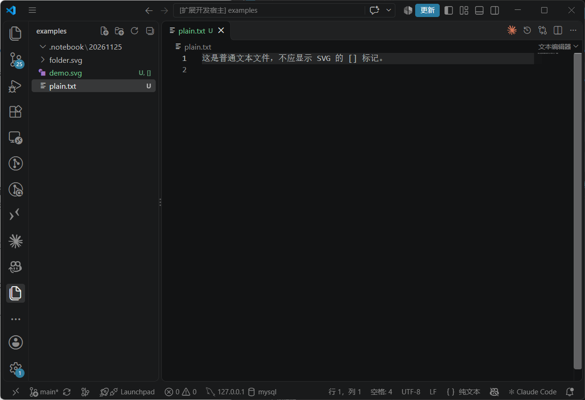
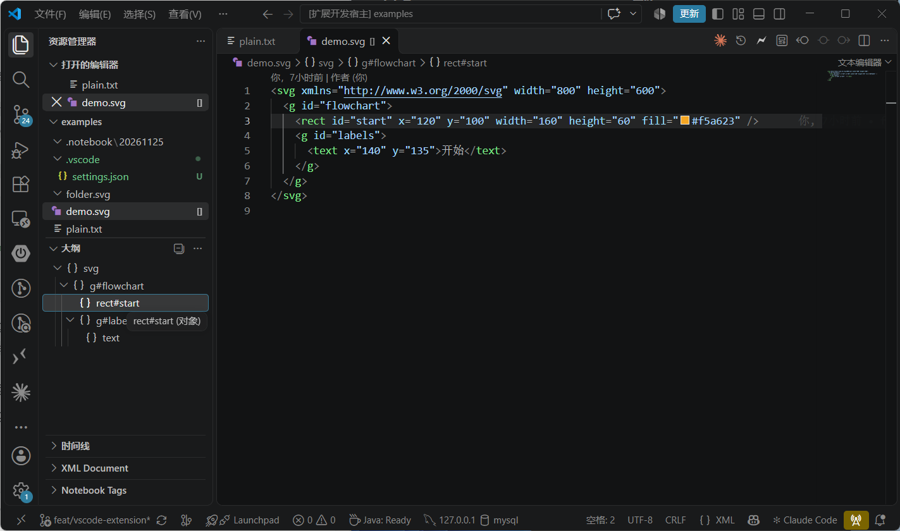
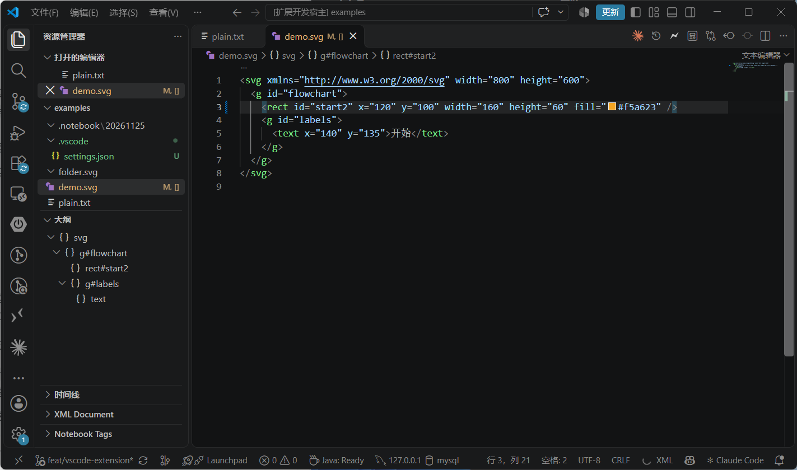
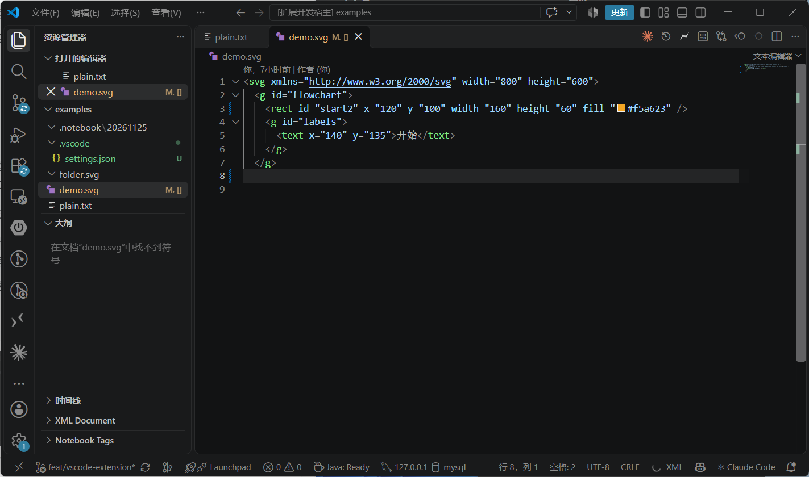
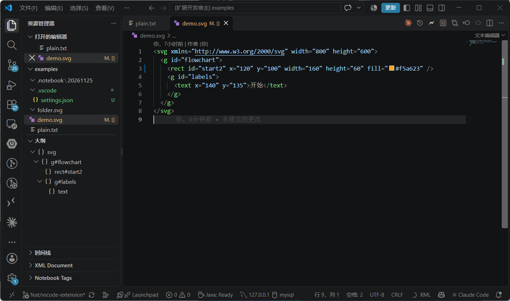
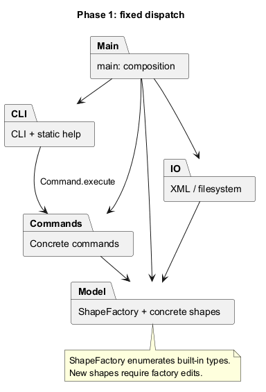
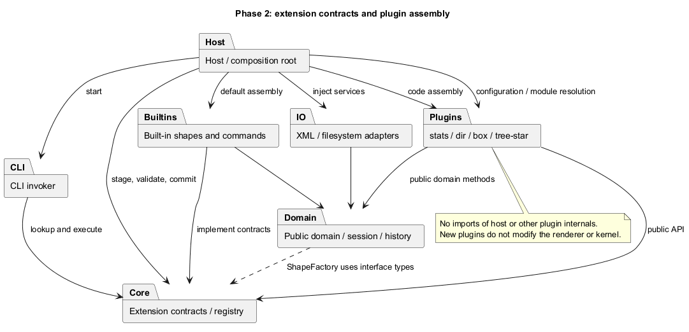

# Lab1 Phase 2：插件实践与插件式重构

项目包含 VSCode SVG 扩展和 CLI 插件式重构。必做功能已实现，测试与验证材料
已保存；当前收尾文档仍需提交、合并和推送，最终提交的 p2 tag 尚未创建。
Phase 1 的原文档与源码保留在 Git 的 final tag，不移动已有 tag。

## 1. 安装与运行

需要 Node.js/npm、Git 和 tar，VSCode 最低版本为 1.85。在仓库根目录执行：

```powershell
npm ci
npm --prefix vscode-extension ci
npm run cli
```

npm run cli 会先编译，再启动同一套 dist 类，避免源码类与编译类混用。
无参数使用代码装配，加载 stats、dir、box、tree-star。其他启动方式：

```powershell
npm run cli -- --config plugins.config.json
npm run cli -- --config plugins.box.config.json
npm run cli -- --config plugins.disabled.config.json
npm run cli -- --no-plugins
```

根配置与默认代码装配使用同样四个插件；box 配置只加载前三个，用于关闭星号。
disabled 配置与 --no-plugins 只保留原命令及六种图形。框架允许空注册表启动，
默认宿主则始终装配内置能力。输入 help 查看已注册命令，Ctrl+C 退出。
相对文件路径以进程工作目录为准，read/save 不改变该目录。

## 2. VSCode 扩展

在 VSCode 单独打开 vscode-extension 文件夹，按 F5 选择“运行 SVG 扩展”。
开发宿主会打开 examples；用文本编辑器打开 demo.svg，展开原生“大纲 / Outline”。
如果大纲隐藏，可通过命令面板 View: Open View 选择 Outline。
示例设置已将 *.svg 关联到 default 文本编辑器，避免图像预览干扰定位。
修改代码后重启调试加载新版本。

### 职责、注册和回调

VSCode 提供 Explorer、原生 Outline、文本文档、文件系统服务、编辑更新和跳转。
扩展提供文件装饰和 SVG 符号数据。activate 注册两个提供者，返回的 Disposable
放入 context.subscriptions，由宿主在停用时清理。

| 提供者 | 注册与调用 | 行为 |
| --- | --- | --- |
| SvgFileDecorationProvider | window.registerFileDecorationProvider；provideFileDecoration(uri, token) | 检查后缀和真实 FileType，返回 []，propagate=false；不改文件名或内容 |
| SvgDocumentSymbolProvider | languages.registerDocumentSymbolProvider；provideDocumentSymbols(document, token) | 返回有 children、range、selectionRange 的 DocumentSymbol，包含根、容器和叶子 |

普通文件和目录不加标记，即使目录叫 folder.svg；缺失文件或取消请求返回空结果。
对照原生 JSON 大纲的树形展示，SVG 大纲有 ID 时显示 tag#id，无 ID 显示 tag。
SvgOutlineParser 保留 UTF-16 偏移，完整元素范围用于层级，标签名范围用于点击定位。
每次读取当前缓冲区，未保存的编辑也更新；XML 不完整时清空，修复后恢复。
不另建自定义侧边栏，也不加载外部实体。

### Decorator、Adapter 与复用分析

经典 Decorator 实现与被包装对象相同的接口，组合并转发调用，再附加职责。
FileDecorationProvider 没有包装文件或转发读写，而是给宿主返回附加元数据，
因此主要是 Provider 注册/回调机制，并非严格的经典对象 Decorator。
CLI 的 HistoryEditCommand 同样实现 Command 并包装原命令，更符合经典 Decorator。

从 Adapter 角度，宿主是 Client，FileDecorationProvider 是 Target，文件提供者
将 URI/stat 数据适配为 FileDecoration；这是数据适配，不是包装文件对象。
大纲提供者则组合纯解析器，把元素树和偏移转换为 DocumentSymbol、Position、Range。

Phase 1 可复用遍历与分层思路，但 CLI 模型包含 ID 补全、类型限制及领域约束，
也不保存源码位置，不能直接作为大纲数据源。因此使用独立只读解析层；共享纯 XML
能力是可能的，但不能把 CLI 约束强加给编辑中的 SVG。

### 运行证据

2026-11-25 在开发宿主中验证标记、层级、第 3 行定位、ID 更新及异常恢复。
自动测试使用接口替身，真实界面由以下截图补充验证。











## 3. CLI 架构与扩展点

接口在 src/core/extensions.ts，插件公共入口为 src/core/index.ts。
插件以类或类实例实现扩展，只依赖公开接口及领域对象，不依赖宿主或其他插件内部。

| 目录 | 职责 |
| --- | --- |
| src/core | 扩展契约、注册表、公开 API |
| src/model | Shape、Group、SvgDocument 等领域对象及 ShapeFactory 分发 |
| src/commands | 命令接口、会话、快照历史和事务装饰、读写接口 |
| src/cli | 参数解析、注册命令查找和执行 |
| src/infrastructure | XML、文件和目录访问适配器 |
| src/plugins | 内置图形/命令，以及可选插件实现 |
| src/host、src/main.ts | 组合根、代码/配置装配、加载和启动 |

Group 是公开的通用组合领域对象，不是内核引用的具体提供者；box 组合它复用容器
行为，矩形等叶子类及提供者留在插件侧。

### 扩展点清单

| 接口 | 职责与实际调用位置 | 当前实现 | 缺省及违规行为 |
| --- | --- | --- | --- |
| ShapeProvider | src/model/ShapeFactory.ts：create/fromSvgElement 创建与读回 | builtin-shapes 的六个 Provider、box/BoxProvider | 未注册报 unknown shape type；返回值须为同 ID 的 Shape；读回最高优先级多重匹配拒绝 |
| Command / CommandContribution | src/cli/CliApplication.ts：run 查找并 execute；builtin-commands/HelpCommand.ts：execute 查询帮助元数据 | 19 个内置贡献、StatsCommand、DirCommand | 未加载不进 help，执行报 unknown command；执行错误输出 error 后继续 |
| TreeDecorator | builtin-commands/commands/TreeCommand.ts：withTags 为根和节点追加标签 | BoxTypeDecorator、ModifiedStarDecorator | 无标签时原 tree 逐字节不变；非字符串或含换行的返回值报 invalid tree decorator result |
| AttributeHandler | builtin-commands/commands/SetCommand.ts：execute 匹配后 apply | BoxAttributeHandler 的 fill/label | 无匹配回退白名单；多重命中报 ambiguous attribute handler；部分失败回滚，不再走默认处理 |

表中的 builtin-commands 均位于 src/plugins/。ExtensionRegistry 在注册时检查
名称与必要方法，不完整贡献报 invalid extension；同类重名报 duplicate registration。
完整错误由宿主或 CLI 加 error 前缀。handles/canRead 必须是纯判定，不能修改文档。

## 4. 插件装配与加载

| 包 | 贡献 | 位置 |
| --- | --- | --- |
| @svgframe/plugin-command-stats | stats 命令 | src/plugins/stats |
| @svgframe/plugin-command-dir | dir 命令 | src/plugins/dir |
| @svgframe/plugin-shape-box | box、box-attributes、box-type-label | src/plugins/box |
| @svgframe/plugin-tree-star | modified-star | src/plugins/tree-star |

方式 A 在 src/host/codePlugins.ts 实例化后调用 PluginLoader.loadInstance。
方式 B 由加载器读根 plugins.config.json：

```json
{
  "plugins": [
    { "module": "./src/plugins/stats" },
    { "module": "./src/plugins/dir" },
    { "module": "./src/plugins/box" },
    { "module": "./src/plugins/tree-star" }
  ]
}
```

module 是路径或包名；enabled 缺省 true，false 完全跳过解析与求值；options
作为原始 JSON 值传给 activate，不做全局合并。按数组顺序加载，相对路径以配置
文件目录为基准，包名遵循该目录的 Node 解析规则。整个配置先验证再激活。
--config 只加载指定列表，不额外叠加代码列表。

插件 package.json 的 name、main、contributes 提供包信息，声明四类名称数组，
缺省为空；默认导出带同步 activate 的类或实例。源码包 main 指向编译后的入口，
需先构建。配置装配以包声明为准；代码声明与包声明的一致性有测试。
box 可接受 options: {"fill":"orange"} 设置创建时颜色，默认颜色为 #4a90d9，非法选项拒绝；
其他当前插件没有业务选项。读回 box 保留文件中的颜色，不用创建模板覆盖。

A/B 最终都调用 activatePlugin，经暂存、注册、清单核对后一次提交。
加载器不硬编码插件导入或名称映射。顶层模块解析与求值分别捕获，缺失依赖不会
误报为顶层插件不存在。失败撤销当前插件全部暂存注册，保留已成功插件并继续。

| 情况 | 输出 |
| --- | --- |
| 顶层模块找不到 | error: plugin not found: &lt;module&gt; |
| 无默认导出 | error: plugin has no default export: &lt;module&gt; |
| 声明和注册不符 | error: plugin manifest mismatch: &lt;name&gt; (declared: …, registered: …) |
| 求值、依赖、构造或激活失败 | error: plugin failed to activate: &lt;name&gt; (&lt;reason&gt;) |
| 同类重名 | error: duplicate registration: &lt;category&gt;/&lt;name&gt; |
| 配置缺失、语法或结构错误 | error: invalid plugin config |

非法配置仍以默认内置能力启动。内置能力自身装配失败则抛错，避免损坏默认能力。

## 5. 命令与目录访问适配器

stats 按画布子节点顺序 DFS，叶子类型按首次出现顺序计数；g、box 只计入
containers，内部叶子仍计数，根 svg 不计入。叶子使用 data-kind（若有）或标签名。
空文档输出 (total 0, containers 0)。它读取当前文档，不进入历史。

dir 在 init 前也可用，不访问 SVG 文档或保存路径。DirectoryReader 是 Target，
NodeDirectoryReader 是 Adapter，Node fs/Dirent 是 Adaptee，DirCommand 是 Client。
接口的 currentDirectory/read 返回 cwd 与 name/kind 数据，不暴露 Node Dirent。
A/B 均从 PluginContext.directories 获得同一接口，可替换成测试替身。

dir 只列直接子项，含隐藏项，不含 . 和 ..；目录在前、文件其次，各组按 UTF-16
名称升序排序，区分大小写且不依赖语言环境。链接与其他特殊项分别在后面显示
[LINK]、[OTHER]，不遍历目标；[DIR]/[FILE] 等标记之后统一两个空格。
空目录输出 (empty directory)，读失败输出 error: cannot read directory: &lt;cwd&gt;。
成功和失败都不改变文档、保存点、cwd、undo/redo，也不触发或解除 IO 撤销限制。

## 6. 架构变化与设计决策

Phase 1 的固定图形工厂、静态帮助改为注册表分发；具体图形和命令迁入插件侧，
宿主负责实例化、服务注入和模块加载。Command 封装操作，HistoryEditCommand
以经典 Decorator 增加历史事务，Group/BoxShape 体现 Composite，目录访问采用
Adapter，注册机制支持 OCP。





PlantUML 源码：[重构前](architecture-before.puml)、[重构后](architecture-after.puml)。

### ADR-001：属性契约与事务

处理器从 AttributeContext 获取 Shape/SvgDocument，通过公开方法访问子部件。
handles 不修改文档；多个处理器命中一律拒绝，不按注册顺序覆盖。
set 由 HistoryEditCommand 包装，CommandHistory.executeEdit 先克隆文档，成功仅
加入一个 undo 单元并清空 redo；失败恢复文档，不压 undo、不清 redo。
即使一次修改多个部件也整体撤销；apply 抛错不回退默认处理。
验证见框架及 box 的冲突、整体撤销和部分失败注入测试。

### ADR-002：读回提供者选择

ShapeProvider 负责 create、canRead、read；read 使用递归上下文，不依赖其他插件
内部类。readPriority 缺省 0，最高优先级仍多重命中则拒绝；box 为 100，普通 g 为 0。
提供者返回值须为同 ID 的 Shape；ID 唯一性由 SvgDocument 和解析器全局检查。
只有整个读取成功后才替换当前文档，框架不按 box 名称分支。

### ADR-003：激活校验与回滚

顺序为暂存→同步 activate→按四类名称集合核对 contributes→提交。
缺省声明为空，不接受声明重复或实际重名；结束后注册上下文关闭，不能异步追加。
失败不影响旧注册。activate 只能注册及创建自身状态，不修改活动文档或旧实例；
注册回滚不承诺撤销任意外部副作用。配置和模块加载留在宿主，不进入内核。

### ADR-004：保存点与标签协议

成功 save/read 后会话保存文档快照，对外返回副本；init 后没有保存点。
undo/redo 只恢复活动文档，不移动保存点。TreeLineContext 提供当前文档、保存点和
节点，根节点用 undefined。空标签跳过，其他标签按注册顺序用一个空格连接，禁止
换行。默认先 box-type-label 后 modified-star，因此为 (box) *；两插件互不感知。

### ADR-005：box 子树和必要部件

create box 的参数为 id、x、y、w、h、标题，可接 in 子句。先在文档外构建子树，
再检查全局 ID，任一冲突整条命令失败，不残留容器或部件。
派生 ID 固定为 &lt;id&gt;-rect、&lt;id&gt;-label，标题初始位置为 x+20、y+35。
拒绝负尺寸或非有限数值，允许零尺寸。

BoxShape 组合公开 Group，借助 createShape 服务生成 rect/text，不导入内置插件。
必要部件必须是对应 ID 和类型的直接叶子子节点；removeChild 拒绝分离它们，因此
delete/addto/group/front/back 不能破坏结构。额外子节点和嵌套 box 可正常编辑。
canUngroup 策略抛出 cannot ungroup composite shape: &lt;id&gt;，整体删除仍可一次撤销。
fill/label 处理器调用 setBodyFill/setTitle，分别修改内部矩形和文字，不扩张内核白名单。

### ADR-006：box 读回和降级

序列化为带 data-kind="box" 的 g，内部仍为标准 rect/text。安装插件时识别并保留
文件中的样式、transform、文字和额外子节点；缺必要部件、类型错误或重复 ID 则
拒绝整个 read，原文档、路径、保存点和历史不变。
未装插件时普通 g 提供者接管，子树保留，但无 box 的保护、label 语义和类型标签。
降级后再次保存会移除 data-kind，不承诺自动恢复复合语义。
XML 属性顺序不属于读回语义；克隆及 undo/redo 保留精确快照和样式插入顺序。

### ADR-007：dirty 内容语义和祖先传播

比较当前模型序列化与最近保存点，不按“曾执行过编辑命令”标记。新文档的根和
新节点立即标记；子树变化自然标记祖先，未变兄弟节点不标记。
节点额外比较 parentId，归属变化也标记；同级排序变化只标相应容器，画布尺寸
变化只标根。保存/成功读入清除；失败不改变；undo 回保存点消失，redo 后恢复。
不通过 undo 而改回保存内容也消失。
ModifiedStarDecorator 的 baselineXml 和 savedShapes 都在实例字段中；保存点变化
重建索引，init 清空，没有模块级可变状态，也不修改文档或历史。

## 7. 测试、会话与提交证据

```powershell
npm run typecheck
npm test
npm --prefix vscode-extension run typecheck
npm --prefix vscode-extension test
npm run test:compat
npm run test:assembly
node scripts/verify-box-boundaries.cjs
```

本地核对：CLI 58 项、扩展 8 项测试通过；三组 final 兼容性、六组双装配的 stdout
和保存 SVG 逐字节一致。扩展测试为 Outline 4 项、装饰及注册 4 项，配合真实截图。
插件可独立测试，例如 node --test test/box.test.cjs；其他插件也有独立测试文件。
框架/加载器测试覆盖缺省、四类失败、重复注册、全量回滚及继续运行；dir 有替身
和真实临时文件系统测试；box、属性、标签有失败与状态机测试。

### 会话文件

| doc/transcript 输入 | 范围 |
| --- | --- |
| cli-1.txt | Phase 1 §6 基础会话 |
| cli-flowchart.txt | Phase 1 §6.1 版本 A |
| cli-commands.txt | 补充全部内置命令及代表性错误 |
| cli-plugins.txt | stats、dir 及历史不变 |
| cli-box.txt | Phase 1 §6.1 版本 B |
| cli-box-boundaries.txt | 嵌套、读回、ID 和部件保护 |
| cli-tree-star.txt | 编辑、保存、撤销与两标签共存 |

输入只含命令和注释，预期输出和所需 SVG 独立保存。fixtures/other.svg 是固定
读入素材；expected/ 顶层为 final 实际输出和保存 SVG，expected/assembly 为当前
双装配输出，expected/no-star 保留接入星号前的 box 输出。

verify-phase1.cjs 从 final 导出并编译，对当前版本显式传 --no-plugins，再比较三组
会话。verify-assembly.cjs 比较代码与根配置的同样六组会话，逐字节核对输出和保存
SVG。每次重置同一路径的固定临时 cwd；日志不写进 dir 列出的目录。
不会覆盖仓库根目录的手动 SVG。兼容性脚本的临时依赖链接需要系统允许 junction/symlink。
日常运行不加 --record，避免重写预期。这些是开发验证脚本，不是 CLI 的新增功能。

### 开闭原则的提交证据

过程提交保留 VSCode 实践、框架、加载器、命令插件、box、标签等节点。
box 的两条演示历史从同一个 8408426 出发：

| 方式 | 接入提交 | 已有运行源码变化 |
| --- | --- | --- |
| A：代码装配 | 73939b8 | 只修改 src/host/codePlugins.ts，另新增 box 包 |
| B：配置装配 | d812658 | 不修改旧运行源码，新增同一 box 包并修改根配置 |

两次插件源码相同，bde7b11 合并两条历史，随后已通过 PR 合入 main。
星号接入为 69e135f，仅新增标签包并修改装配/配置及验证材料。

```powershell
git diff --name-status 73939b8^ 73939b8 -- src
git diff --name-status d812658^ d812658 -- src
git diff d812658^ d812658 -- plugins.config.json
git diff 73939b8 d812658 -- src/plugins/box
```

边界验证脚本先确认保护路径存在，再比较内核、加载器和旧插件差异，避免用不存在
路径的空 diff 冒充通过。A/B 运行时插件集合、顺序、options、初始文件和 cwd 一致。
当前默认集合后来加入星号；原接入证据以各自提交为准，不把后续新增算作原接入修改。

## 8. 指标

[自动指标报告](../docs/metrics/README.md) 与 report.json 位于 docs/metrics/。
文件职责、内核/装配处/插件三类行数、圈复杂度增量均由 scripts/metrics.cjs 从 Git
历史生成，排除测试、依赖和构建产物；VSCode 单列，不混入 CLI 增量。
文件迁移引起分类变化，不等于总体复杂度降低。

```powershell
npm run metrics
# 最终 tag 存在后可复核 final/p2：
npm run metrics -- --from final --to p2
```

报告注明比较的提交。文档收尾不改变运行源码时，指标相同；已有 tag 不移动。
数字不能手填。当前报告对应全部必做功能完成后的源码提交。

## 9. 协作检查与修正

| 检查点 | 修正或决定 | 核验 |
| --- | --- | --- |
| 旧 TypeScript 选项弃用 | 改为 Node16 配对配置 | 扩展类型检查和编译 |
| 后缀判断会误标目录 | 检查真实文件类型 | 文件/目录单测与截图 |
| CLI 模型没有源码范围 | 使用独立只读解析层 | 无 ID、定位、编辑、异常恢复 |
| SVG 默认打开图像预览 | 示例关联文本编辑器 | 点击定位截图 |
| 属性可能部分修改后失败 | 单一事务，回滚后不走默认分支 | 多部件及失败注入测试 |
| 插件接入是否真正符合 OCP | 分开保存 A/B 提交 | Git 差异与边界核验 |
| dirty 不能只记编辑事件 | 比较保存点，实例缓存隔离 | 保存/undo/redo 状态测试 |
| 指标不能手填或保留旧数据 | Git 历史自动生成 | 文件、行数和复杂度报告 |

## 10. 实现范围与交付

不实现完整 SVG 标准或 VSCode 图像预览。CLI 沿用 Phase 1 的尺寸/viewBox 规则和
受支持属性；额外 CSS/字体属性可能不保留，根 svg 的 transform 不支持。
历史使用完整快照，适用于本实验规模；插件须遵守同步激活及公开领域契约。
选做图形和额外扩展点未作为必做内容实现。
收尾分支提交、推送并普通合并到 main，最终核验后创建并推送 p2；保留开发提交，
已有 final 或其他 tag 不移动。
