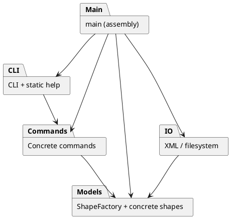
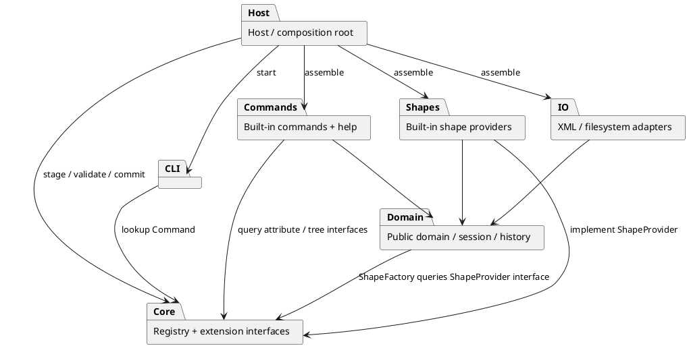

# CLI 插件框架（第一步）

本步建立四个扩展点、内置能力的注册装配和公共插件 API。
stats、dir 已在后续命令阶段接入，见 [命令插件](command-plugins.md)。
box、属性处理及 `(box)` 标签已在独立 A/B 提交中接入，见 [Box 插件](box-plugin.md)；
modified-star 也已独立接入，详见 [未保存变化标签](tree-star.md)。配置模块加载器已在
框架后的独立基础设施阶段实现，详见 [加载与目录访问](plugin-loading.md)。
本步的测试插件只验证契约，不冒充这些必交插件。

## 代码边界

| 目录 | 职责 |
| --- | --- |
| src/core | 扩展接口、注册表、公共 API 门面 |
| src/model | Shape、Group、SvgDocument 等公开领域对象及图形分发 |
| src/commands | Command 接口、会话、历史、事务装饰和读写接口 |
| src/cli | 参数解析与纯命令查找，不枚举具体命令名称 |
| src/infrastructure | XML 和文件访问实现 |
| src/plugins/builtin-shapes | 六种默认图形的提供者及叶子类型实现 |
| src/plugins/builtin-commands | 既有命令实现、命令元数据适配器及动态帮助 |
| src/host | 组合根和插件激活暂存/验证 |
| src/main.ts | 调用组合根并启动 |

Group 是公共的通用组合领域对象，负责嵌套、移动、克隆及普通分组操作；
不是由内核引用的具体 ShapeProvider。具体提供者、叶子图形和命令实现位于插件侧。
插件公共入口为 `src/core/index.ts`，新插件不导入宿主、注册表或其他插件的内部文件。

## 扩展点清单

接口定义：`src/core/extensions.ts`；命令的 execute 契约沿用
`src/commands/Command.ts`，CommandContribution 补充 name、help、section。

| 接口 | 职责及内核调用位置 | 当前实现 | 无可选插件时 | 违反契约 |
| --- | --- | --- | --- | --- |
| ShapeProvider | ShapeFactory.create / fromSvgElement 分发创建与读回 | builtin-shapes 中六个 Provider 类；box/BoxProvider；测试 MarkerProvider | 默认六种图形；未注册类型报未知类型；缺 box 时读回普通 g | 重名拒绝；方法不完整拒绝；创建/读回须返回同 ID 的 Shape；最高读回优先级多重命中拒绝 |
| Command / CommandContribution | CliApplication.run 查找 name 并 execute；HelpCommand.execute 查询帮助元数据 | 19 个内置命令贡献，NamedCommand 适配既有命令；独立 StatsCommand、DirCommand 插件；测试 PingCommand | 禁用可选插件后原命令和帮助输出不变；未注册命令报 unknown command | 名称不一致、缺方法/帮助/分组拒绝；执行错误由 CLI 输出 error 并继续 |
| TreeDecorator | TreeCommand.withTags 为根标题和各节点追加标签 | box/BoxTypeDecorator、tree-star/ModifiedStarDecorator；测试 FixedTag | 无标签插件时 tree 逐字节保持原样；只关星号时保留 box 标签 | 重名拒绝；非字符串或带换行的返回值报 invalid tree decorator result |
| AttributeHandler | SetCommand.execute 在原属性规则之前匹配并调用 | box/BoxAttributeHandler，处理 fill/label；测试 PairAttribute | 回退原图形白名单；未定义属性报 unknown attribute | 多重匹配拒绝；处理器抛错整体回滚，不再尝试默认处理 |

TreeCommand 和 SetCommand 是框架接入接口的内置命令实现，位于插件包内。
上述调用位置是框架控制流中的实际调用点，新增标签或属性处理器时不再修改它们。

## 代码装配与激活

`src/host/createApplication.ts` 创建 registry、session、history、factory，
通过 `activatePlugin` 激活 BuiltinShapesPlugin 和 BuiltinCommandsPlugin。
具体实现的选择集中在组合根。插件拿到 PluginContext 的四个注册方法、
EditorAccess 和 createShape 服务。服务使用公开领域接口，不暴露注册表内部字段。

`activatePlugin` 复制已注册条目至暂存表，调用同步 activate，将新注册名称按四类
与 contributes 清单比较，顺序不影响集合校验，实际注册顺序保留用于运行。
成功后提交；激活抛错、重名、清单不符均丢弃暂存表，已有插件不受影响。
激活结束后注册上下文关闭，不能异步追加。activate 只允许注册及创建自身状态，
不得修改活动文档或已有插件实例；注册回滚不承诺撤销任意外部副作用。

基础设施阶段新增 PluginLoader，代码与配置装配均通过 activatePlugin 的暂存、
校验路径。可选插件失败由加载器输出约定错误并继续启动；宿主自身内置能力若装配
失败仍抛错，避免以损坏的默认能力启动。

## ADR-001：属性分发与撤销事务

处理器通过 AttributeContext 获取当前 Shape 与 SvgDocument，调用公开方法访问
子节点并修改，不接触字段。handles 必须纯判断。多个处理器命中时拒绝，错误为
`ambiguous attribute handler: <attr>`；不按注册顺序静默覆盖。

组合根将 set 包装在 HistoryEditCommand 中，由 CommandHistory.executeEdit 在执行
前克隆文档，成功后仅推入一个 undo 单元并清空 redo。任何 handles/apply/default
处理错误都恢复原文档；失败不压入 undo、不清除 redo。apply 部分失败不进入默认分支。
一次处理器调用可以修改多个部件，仍整体撤销/重做。处理器只可修改活动文档，
不可通过全局状态或宿主私有引用更改历史或文件路径。

验证：framework.test.cjs 的 multi-shape、fallback/conflict、partial failure 三组测试。

## ADR-002：图形读回与降级能力

每个提供者同时负责 create、canRead 和 read。canRead 是纯判定，read 接收递归读回
服务。readPriority 缺省为 0，选择最高优先级；同优先级多个命中拒绝，避免注册顺序
决定类型。未来 box 使用较高优先级识别 data-kind；未加载时普通 g 提供者仍能读回
为 Group。框架不写 box 名称分支。提供者返回值必须是同 ID 的 Shape。

新增子树的全局 ID 唯一性沿用 SvgDocument.addShape；解析阶段重复 ID 检查仍由
SvgXmlParser 完成。完整解析成功后才由 ReadCommand 替换活动文档。
损坏 box 的具体拒绝策略和必要子部件保护，在 box 插件接入时补充。
Shape.canUngroup 为复合容器保留可覆盖的策略，普通分组行为保持原样。

验证：framework.test.cjs 的 specialized read priority / fallback / ties。

## ADR-003：激活校验时机及失败隔离

按“暂存 → activate → 核对实际新增集合 → 提交”的顺序执行。四类同名均不允许；
插件不能替换已有条目。声明缺省为空集合，声明重复名称也不接受。
框架只支持同步激活，并关闭结束后的注册能力。配置解析与模块加载属于宿主，
不进入内核；已实现的 PluginLoader 沿用此契约并报告约定错误。

验证：framework.test.cjs 覆盖激活抛错、清单不符、四类重复、继续激活后续插件、
上下文关闭及非法贡献。

## ADR-004：保存点与树标签组合

会话保存最近成功 save/read 的文档快照，对外返回副本；init 后没有保存点。
undo/redo 恢复活动文档而不移动保存点。TreeLineContext 同时提供活动文档、保存点
和当前节点，根标题节点为 undefined。标签按注册顺序以一个空格拼接；空字符串
跳过，不允许换行。未装标签完全不追加空格。

modified-star 已选择“与保存内容比较”的 dirty 语义，新增节点立即标记，
对子树序列化比较使祖先随子节点变化标记，undo 回到保存点标记消失。
具体实现和编辑→保存→再编辑→undo 的独立及集成状态测试已在标签插件阶段完成。

## 架构图

重构前：

重构后：

## 验证、指标和 AI 检查

`npm test`：11 项框架测试通过。`npm run test:compat`：三个会话的 stdout 和保存 SVG
与 final 逐字节一致。覆盖范围是固定会话与契约边界，不代表全部 SVG 规范。

`npm run metrics` 从 final 与已提交 HEAD 的 Git 源码生成 docs/metrics 的报告，
包含按目录分类的行数、按函数的 McCabe 复杂度与职责清单，VSCode 单列。
工具复用扩展子项目声明的 TypeScript compiler API，因此运行前需安装扩展依赖。
框架提交后的报告已经重新生成，明确记录其 Git 提交哈希；每次后续提交后可重新运行。
报告不计未提交改动，最终使用 `npm run metrics -- --from final --to p2`。

对 AI 方案的检查：未将属性处理失败转入默认分支，避免掩盖部分修改；未让帮助
生成继续留在 CLI 的名字分支中；将具体图形和命令迁入插件目录后检查核心没有
反向导入插件；以真实 final 运行结果校验帮助文本、提示符、错误和序列化字节。
指标读取 Git 提交对象，不把未提交代码伪称为 p2，也不移动已有 tag。
